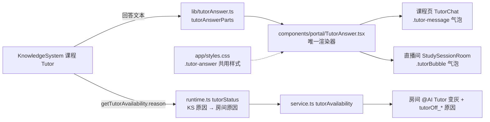

# AI Tutor 回答层：课程页与学习小组共用（2026-11-06）

## 为什么

Portal 里有两处显示 AI Tutor 的回答：课程学习页右侧的 AI Tutor（`TutorChat`，一对一流式）和学习小组直播间的 @AI Tutor（`StudySessionRoom`，排队后广播给全房间）。两处的回答都来自 KnowledgeSystem 的同一个课程 Tutor（`services/ksTutorClient.ts`），文本格式完全相同。

2026-11-06 之前，这两处各有一套渲染和样式：

| | 课程页（原 `TutorMarkdown.tsx`） | 直播间（原 `TutorAnswer.tsx` + `modules/group-study/tutorAnswerText.ts`） |
|---|---|---|
| `\( \)` / `\[ \]` 转 `$` / `$$` | 有，跳过代码块 | 有，**代码块里也转** |
| 来源 `Sources` / `[Source: …]` | 改成引用块；`[Source: …]` 不处理 | 抽出来，答案下面一行一个 |
| 一行一个段落 | 没有，单换行被并成一段 | 有，但**代码块里也插空行** |
| `2*3*4` 不当强调 | 没有 | 有 |
| 链接 | 只放行 http(s) | 任意（靠 react-markdown 默认过滤） |
| KaTeX 选项 | `trust:false, maxExpand:100` | `strict:"ignore", output:"html"` |
| 课程图片代理正则 | 一份 | 同一份复制 |
| 样式 | `app/styles.css` `.tutor-message .markdown-answer`，`.markdown-sources` 规则从没生效 | `study-groups.module.css` `.tutorAnswer` / `.tutorSources` |

而且课程页反过来依赖学习小组模块（`normalizeTutorIndent`）。同一份回答在两处显示不一样，修一处另一处不跟着好。

另外，KS 会告诉 Portal Tutor 为什么不可用（`TutorAvailability.reason`），直播间把它压成了一个布尔值，房间只能说"离线"。

## 设计



- **D1 解析**（`lib/tutorAnswer.ts`）：取两边各自做对的部分合成一个 `tutorAnswerParts(text) → { markdown, sources }`。2026-11-08 起，三个问题各只在一处判定（之前是几道正则各猜一次，会互相打架）：
  1. **什么是代码**：只有围栏块（行首 ``` / ~~~）和行内反引号。缩进永远不算代码：解析器关掉了"缩进代码块"（`remarkTutorNoIndentedCode`），因为 KS 会缩进普通文字，比如图片后面那段。
  2. **什么是公式**：`\( \)`、`\[ \]`、`$$ $$`，以及按 Pandoc 规则认的 `$ $`（开头的 `$` 后面紧跟非空白，结尾的 `$` 前面紧跟非空白、后面不是数字）。其余的 `$` 都是美元符号，所以"$5 和 $10"还是钱数。代码和公式由同一次扫描找出来（`tutorAnswerSegments`），再按解析器唯一认的写法交给它（行内 `$ $`，独立成行的 `$$` 块）。
  3. **段落在哪断**：一行一个段落。这一步放在解析之后（`remarkTutorLines`），所以跨行的粗体、链接、公式不会被拆开；解析前只在文字和列表、表格、引用、标题、围栏块、`$$` 块的交界处补空行（`layoutLines`）。

  另外：来源抽出（`[Source: …]`、`【来源：…】`，以及结尾的 `Sources` / `来源` 编号列表，缩进也认）、`数字*数字` 不当强调。课程页"复制纯文本"也走同一次扫描（`tutorAnswerPlainText`）：公式保留 TeX、代码原样、去掉 Markdown 标记、来源附在最后。`\[ \]` 一般是公式块；只有夹在句子中间（同一行前后还有文字）、里面又只有普通文字或数字、没有任何 TeX 符号时（如"下标 `\[1\]` 是"），才按 Markdown 的转义方括号显示成 `[1]`。独占一行的 `\[ \]` 永远是公式。
- **D2 渲染**（`components/portal/TutorAnswer.tsx`）：两处都用它。只放行经 Portal 权限代理的课程图片；链接只放行 http(s)，新窗口打开且不带来源；不渲染原始 HTML；KaTeX 用两边选项的并集（`trust:false, maxExpand:100, strict:"ignore", output:"html"`）。来源固定渲染成 `.tutor-answer-sources`：一个标题行，加每条来源一行。
- **D3 样式**（`app/styles.css` 的 "AI Tutor answer" 一节）：回答内容的排版只此一份，用 `em` 跟随所在气泡的字号（课程页 13px，直播间 12px）。气泡本身仍归各自页面：课程页 `.tutor-message`，直播间 `.tutorBubble`。Tutor 的品牌色收成三个变量（`--lg-tutor-accent` 等），课程页按钮、直播间 @AI Tutor 按钮和头像都用这三个变量。
- **D4 不可用原因**：`runtime.ts` 的 `tutorStatus` 把 KS 原因映射成房间已有的三种：`not-configured` → `no_key`；`http-error` / `timeout` / `network` → `provider_down`；`not-in-ks` / `not-online` / 课程未发布 → `offline`。读取超时（2.5 秒）算 `provider_down`。原来的 `budget` 已经没有来源，删除。

不合并的部分（有意保留）：

- **送达方式**：直播间要排队、轮流、撤回，答案广播给全房间；课程页一对一流式。
- **复制**：直播间是一个复制按钮；课程页有"纯文本 / Markdown"两项菜单。

## 谁会改到这里

改回答格式时只改 `lib/tutorAnswer.ts` 和 `.tutor-answer` 样式，两处自动一致。测试见 `tests/unit/tutor-answer-layer.test.ts`（D1/D2）、`tests/unit/tutor-answer-edges.test.ts`（D1 边缘情况：钱数、缩进、跨行、流式、来源、纯文本复制）、`tests/unit/tutor-chat-markdown.test.ts`（课程页挂载）、`tests/unit/study-group-tutor-answer.test.ts`（直播间），以及 E2E `study-group-live-room-1029.spec.ts` 1029-4。
