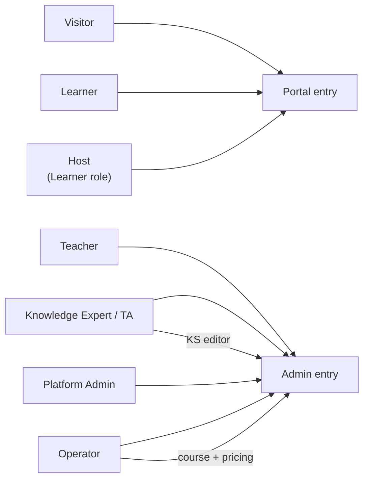
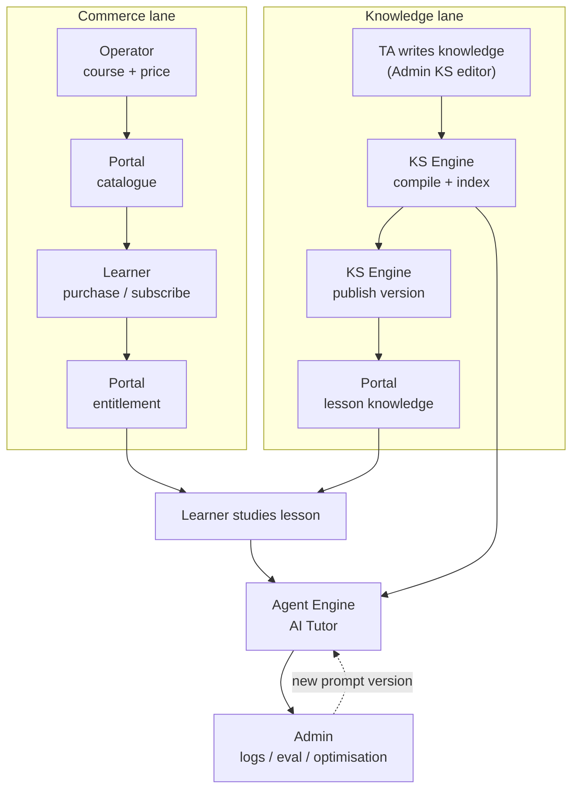

# Learning Guide 系统设计：四组件、两入口、全角色

## 1. 原则

1. 四个组件：**Portal**、**Admin**、**KS Engine**、**Agent Engine**。
2. 只有两个入口：**Portal**（最终用户）、**Admin**（内部人员）。两者独立部署、独立会话。
3. **KS 与 Agent 只是引擎**，没有 UI；配置 UI 属于入口：后端配置在 Admin，运行时配置在 Portal。
4. 组件不共享数据，只通过接口交互；学员运行时只经 Agent。
5. 每份数据只有一个写入者。

## 2. 角色

| 角色 | 入口 | 主要职责 | 不做什么 |
|---|---|---|---|
| **Visitor** 游客 | Portal | 浏览目录/课程详情、看公开首课、看价格与 FAQ、注册 | 学习完整课程、提问 Tutor |
| **Learner** 学员 | Portal | 购买/订阅、学习、看进度、提问 Tutor、参加学习小组 | 改课程、改 prompt |
| **Host** 组长（Learner 的子角色） | Portal | 建组、排期、主持 Live Session、管理成员 | 改课程内容 |
| **Knowledge Expert / TA** 知识专家 | Admin | 在 KS 编辑器写知识点、组织知识树、提交发布、做 Tutor 试跑 | 管价格、订单、学员 |
| **Teacher** 授课教师 | Admin | 自己负责课程的章节/课时内容与发布（LGTeacher） | 其他教师课程、财务 |
| **Operator / Course Manager** 运营 | Admin | 课程商品、价格与计划、上下架、订单/支付/订阅处理、门户内容、报表 | 写知识正文、改 prompt |
| **Platform Admin** 平台管理员 | Admin | 角色与权限、Agent/KS 配置、审计、环境与开关 | 查看学员密码、支付卡数据 |

Partner 的会计/HR/BI 在 Phase 1 不在范围内。

## 3. 组件职责

| 组件 | 是什么 | 承担 | 不承担 |
|---|---|---|---|
| **Portal** | 入口 1（最终用户） | 认证、目录、购买、订阅、学习、进度、小组、Tutor 运行时、通知 | 生产知识、配置 prompt、管课程商品 |
| **Admin** | 入口 2（内部人员） | 课程管理与 LGTeacher 发布、知识编辑（KS 配置 UI）、Agent 配置/测试/调试/优化、订单/支付/订阅运营、报表、角色 | 学员会话、支付回调的主处理 |
| **KS Engine** | 纯后台引擎 | 知识摄取、校验、编译、索引、版本发布、检索 | 课程商品、价格、排期、报名、UI |
| **Agent Engine** | 纯后台引擎 | Tutor 会话编排、检索、模型调用、工具调用、流式输出、日志 | 存课程知识、判权益、保存订单 |

**KS 与 Admin 的分界**：Admin 决定“卖什么课、多少钱、何时上架”；KS 决定“课里教什么知识、何时发布哪一版”。两者通过课程 id 关联，不共享表。

## 4. 角色与入口



## 5. 功能全景

### 5.1 Portal

| 域 | 功能 |
|---|---|
| 访客 | 首页与 Banner、课程目录与筛选、课程详情、公开首课（限时/限段）、Pricing、FAQ、Legal、Cookie 同意、联系表单 |
| 注册与认证 | 邮箱注册 + 24h 验证 + 重发限流、Google OAuth、WeChat 扫码 + 强制邮箱绑定、登录/登出、找回密码、记住密码、returnTo 回跳 |
| 购买 | 服务端报价、Stripe Checkout、支付回跳状态、订单收据 |
| 订阅 | 4 类计划 × 6/12 月、3 天试用（绑定支付方式）、类别→Everything 升级补差、周期末取消、恢复、支付宽限期、到期 |
| 学习 | 我的学习概览（进行中/完成/过期）、继续学习、进度 0–100、课时完成、Knowledge/Understanding 测试、下一课时 |
| 学习小组 | 发现/创建/加入、成员管理、排期、Live Session（LiveKit）、在场状态、组内 Tutor、提醒 |
| AI Tutor | 课程内提问、Lecture/Socratic 模式、流式回答、引用来源、反馈、历史 |
| 账户 | 昵称/语言/密码设置、邮箱绑定、通知已读、订阅记录与收据、帮助 |
| 平台 | 多语言（en-GB / zh-CN）、SEO、可访问性、健康检查 |

### 5.2 Admin

| 域 | 功能 |
|---|---|
| 课程管理 | 课程/分类 CRUD、上下架、公开首课指定、封面与媒体、排序、价格与计划（Stripe lookup key）、有效期 |
| 内容发布 | 章节/课时草稿、富文本与视频/PDF、大纲编辑、发布与回滚、发布校验 |
| 知识编辑 | KS 配置 UI：知识树、页面编辑（Markdown/LaTeX）、示例与题库、素材导入、标签、提交审核、发布版本、覆盖率与缺口 |
| Agent 配置 | prompt 模板与版本、模型与参数、课程策略、上线开关、灰度、沙箱、重放、版本对比、评测集、A/B |
| 学生 | 用户查询、权益与报名、学习进度、邮箱绑定状态、会话吊销 |
| 订单 | 列表/搜索/筛选/详情/CSV、全额退款、异常订单重同步、活动审计 |
| 支付 | Stripe 事件与 Webhook 状态、失败与对账、退款记录 |
| 订阅 | 计划、升级/降级、取消、宽限期、到期与流失视图 |
| 门户内容 | Banner、首页文案、FAQ、Legal、邮件模板、多语言文案 |
| 报表 | 收入、订单、报名、完成率、Tutor 使用与成本 |
| 平台 | 操作员账号与角色、审计日志、环境开关 |

### 5.3 KS Engine

| 域 | 功能 |
|---|---|
| 摄取 | 接收知识稿件（课程/章节/知识点）、校验结构与必填、幂等接收 |
| 编译 | Markdown/LaTeX 解析、分块、元数据与引用锚点、示例与题库关联 |
| 索引 | 向量/关键词索引构建、版本化、增量与全量重建、失败重试 |
| 发布 | 版本发布到 Portal、灰度、回滚到上一版本、发布校验 |
| 检索 | 按课程/快照/范围检索、阈值与 top-k、引用返回 |
| 运维 | 索引状态、积压、重放、快照切换、健康检查 |
| 质量 | 覆盖率（知识 vs 课程大纲）、缺口报告、重复/冲突检测 |

### 5.4 Agent Engine

| 域 | 功能 |
|---|---|
| 会话 | 开场、模式（Lecture/Socratic）、多轮上下文、语言、超时与续接 |
| 检索 | 调 KS、片段筛选、引用、无命中降级 |
| 工具 | 学习进度、权益校验、课程大纲、下一步建议 |
| 回答 | 流式输出、一消息一正文、引用格式、敏感内容与越权拦截 |
| 配置 | 解析生效配置（后端版本 + 运行时上下文）、fail-closed |
| 测试 | 沙箱对话、固定上下文重放、版本 A/B 对比 |
| 观测 | 轮次日志（脱敏）、延迟/成本、失败分类、用户反馈 |
| 优化 | 评测集回归、prompt 迭代、灰度发布 |

## 6. 端到端：知识线与商务线



## 7. 角色 × 功能

| 功能 | Visitor | Learner | Host | TA | Teacher | Operator | Platform Admin |
|---|---|---|---|---|---|---|---|
| 浏览目录 / 公开首课 | ✓ | ✓ | ✓ | ✓ | ✓ | ✓ | ✓ |
| 注册 / 登录 / 找回 | ✓ | ✓ | ✓ | — | — | — | — |
| 购买 / 订阅 | — | ✓ | ✓ | — | — | 只读 | 只读 |
| 学习 / 进度 / 测试 | — | ✓ | ✓ | — | — | 只读 | — |
| AI Tutor | — | ✓ | ✓ | 试跑 | 试跑 | — | 配置 |
| 学习小组 | — | 参加 | 建组/主持 | — | — | — | — |
| 课程商品与价格 | — | — | — | — | — | ✓ | ✓ |
| 章节/课时内容 | — | — | — | — | 自己课程 | ✓ | ✓ |
| 知识编辑与发布 | — | — | — | 自己课程 | — | 审核 | ✓ |
| Tutor prompt / 策略 | — | — | — | — | — | 课程级 | ✓ |
| 订单 / 退款 / 对账 | — | 自己订单 | — | — | — | ✓ | ✓ |
| 学生与权益 | — | 自己 | — | — | 自己课程 | ✓ | ✓ |
| 报表 | — | — | — | — | — | ✓ | ✓ |
| 角色与审计 | — | — | — | — | — | — | ✓ |

## 8. 配置归属

| | KS | AI Tutor |
|---|---|---|
| 配置面 | 只有后端 | 后端 + 运行时 |
| 谁能改 | TA（知识）、Platform Admin（索引参数） | Admin：prompt/策略/上线；Portal：模式/语言/额度 |
| 生效 | 新索引版本 + 快照切换 | 新 prompt/policy 版本，下一轮生效 |
| 回滚 | 切回旧索引版本 | 切回旧 prompt/policy 版本 |

| 配置项 | 后端（Admin） | 运行时（Portal） |
|---|---|---|
| prompt 正文、模型、温度、上限 | 唯一来源 | 不可见 |
| 模式（Lecture / Socratic） | 白名单 | 白名单内选择 |
| 语言、课程上下文 | 默认值 | 必传 |
| 上线开关 | 唯一权威 | 不能开启 |
| 频控与额度 | 上限 | 额度内计数 |
| 日志 / 测试 / 调试 / 优化 | 在这里完成 | 只产生匿名事件 |

## 9. 数据归属

| 数据 | 唯一写入者 |
|---|---|
| 用户、会话、订单、支付、订阅、权益、进度、小组、通知 | Portal |
| 课程商品、价格与计划、上下架、运营账号、审计 | Admin |
| 知识内容、知识版本、索引、发布快照 | KS Engine |
| 对话轮次、生效配置版本、脱敏日志、评测样本 | Agent Engine |

## 10. 接口

```text
Portal  -> Agent   POST /v1/tutor/messages:stream
Agent   -> KS      POST /v1/retrieve
Agent   -> Portal  POST /internal/entitlements/check
Admin   -> Agent   /v1/admin/prompts /v1/admin/policies /v1/admin/online
Admin   -> KS      /v1/admin/knowledge /v1/admin/publish /v1/admin/reindex
KS      -> Portal  published knowledge snapshot
Admin   -> Portal  course catalogue snapshot（只读）
```

## 11. 现状差距

| 现状 | 目标 |
|---|---|
| `admin.*` 由 Portal 进程提供 | Admin 独立部署，Portal 删除 admin host |
| `app/api/backoffice/*` 与前台同库 | 运营归 Admin，学员数据归 Portal |
| 课程正文在 `app_files` 聚合 | 知识归 KS，Portal 只读发布结果 |
| Portal 直连模型 | 只有 Agent Engine 调模型 |
| Admin 单一静态 API Key | OIDC + 角色 + 服务间凭证 |
| 无 KS、无知识版本 | 建 KS Engine 与知识版本 |

## 12. 验收

- 只有两个公网入口；引擎不可从浏览器直达。
- 六类角色各自只能看到本节第 7 条允许的功能。
- 助教在 Admin 编辑知识，经 KS 发布后 Portal 可见，且可回滚。
- 学员提问只经 Agent，Agent 不直连任何数据库。
- 定价、权益、订单事实只由服务端写入，浏览器不可决定。
