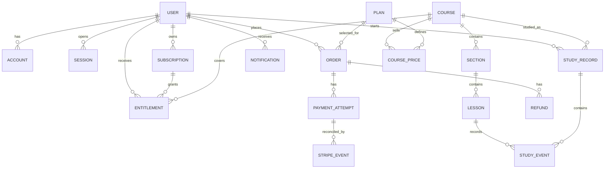

# Phase 1：数据设计

Verified legacy period compatibility (2026-10-17): StripeUpgradeProration optionally retains sourceRecordedValidTo, the unchanged local expiry used to reject concurrent source-record changes. Only after verifying the original paid legacy Checkout may the preview use actual Stripe periodStart/End and billingCycleAnchor instead of callback-time-derived local dates. Re-preview and fulfillment retain those exact provider bounds. Existing modern snapshots keep strict period equality. No historical date rewrite or DDL is needed; browser input cannot enable this server-owned path. Legacy metadata may omit app but must still contain matching Order/User/Plan identifiers, with all provider/payment checks retained.

Legacy Stripe upgrade source (2026-10-17): historical paid Orders may lack a Price snapshot. `LegacyStripeUpgradeSource` carries server-owned original Checkout/Order/User/Plan/customer/subscription identities and the recorded amount/currency for a read-only provider verification. The verified original line-item Price is pinned in the new upgrade Quote; the original Order and Subscription remain unchanged by quoting. No DDL or bulk backfill. Invalid/missing evidence never grants access or produces a fabricated quote.

Course maximum-progress revision (2026-10-17): StudyRecord.progress is the greatest accepted outline percentage over its lifetime; equal/lower candidates never replace it. knowledgePositions/currentMode/currentLessonId remain resume facts and can move backwards independently. Opening text/PDF points or starting a selected video point uses its same-mode ordinal over all active Course outline points; rounding stays below 100 until the final point. ProductStudyEvent gains optional completeLesson for explicit Next Lesson completion. With complete event and a validated learningMode, the service derives that Lesson's last point and expands its read-side completedContentIds to all same-mode points in that Lesson. Completed Study lesson evidence remains separate from reaching a course percentage. Existing record/event JSON storage and unique client event semantics remain, so no DDL or bulk rewrite is required. This supersedes earlier documentation permitting stored progress to decrease or Overview to calculate another completion-only percentage.

Application simulated review revision (2026-10-17): SavedAssessment's existing JSON record gains optional evaluationStartedAt, derived only by the service. Application attempt.phase is answer/evaluating/submitted. Nonblank evaluating answers start or reuse one review; changing an in-flight answer conflicts. Submitted requires the same answer and at least 3000ms since the persisted start, or an already completed identical answer; direct/early completion is rejected. Draft/evaluating keeps completedAt null; completed result stores completedAt and reports one answered question/100%. Existing submitted records remain readable as completed results. Knowledge retains six sample cards, independent per User/Course/Lesson/kind. Evaluation feedback is the explicitly requested simulation, not an external-provider assessment or numeric score. Storage remains the existing lesson_assessments JSONB/local repository, with the same event/version constraints; no DDL or bulk history rewrite.

Subscription/navigation follow-up (2026-10-17): no DDL or historical payment mutation. Receipt display may use an existing Order.stripeCheckoutSessionId when Invoice/PaymentIntent identities were not recorded; it resolves only that original paid Session, never a subscription's latest Invoice. Session/order identity, paid status, amount, currency and recorded subscription must agree before exposing its receipt. Portal navigation uses the read-only contracts/portal-session.ts identity projection; this does not grant Course access or alter subscription facts.

User-confirmed revision: paid subscriptions with auto-renewal off may turn it on again before the original expiry. This supersedes the previous Phase 1 no-restore rule for paid subscriptions. Cancel/resume use separate persisted operation identities and Stripe cancel_at_period_end true/false, retain the same period/anchor and do not create a new purchase or revive expired/refunded access. Trial resume still uses its original trial window.

My Subscription presentation groups product history across terms and repurchases and follows explicit paid upgrade sourceSubscriptionId links into Everything without duplicating the upgraded Category in Past. Subscription displayState derives expiry using validTo/graceEndsAt without changing stored access. An optional renewalChange {id,subscriptionId,action,reasonCode?,reasonText?,completed} is persisted in the existing Subscription payload to recover provider response/storage failures with the same Stripe idempotency key. Local cancellation state/feedback and completion marker are committed atomically. No DDL or history rewrite.

Stripe-prorated upgrade adds optional typed `upgradeProration` snapshots to the existing ProductQuote/ProductOrder payloads (`contracts/stripe-upgrade.ts`). The snapshot pins Stripe subscription/customer/item/source Price, original service period/billing anchor, proration timestamp, debit, unused-time credit, adjustments, invoice total and amount due. Quote/Order amountMinor is invoice.amount_due; price remains the same-term Everything renewal Price. Native upgrade orders retain sourceSubscriptionId and the original stripeSubscriptionId, gain a unique recorded stripeInvoiceId and use the existing serialized aggregate mutation to reserve at most one pending native upgrade for that source and reject conflicting Category purchases. Stripe update idempotency is derived from the persisted Order id; Stripe event identities and invoice association are deduplicated within the existing atomic persistence path. Payment success expires local Category entitlement and creates Everything entitlement using the original period start/end and same Stripe subscription/customer. Pending/failed upgrade invoices do not extend Category access or grant Everything; voided invoices cancel the pending order. Existing upgradePrice snapshots are historical one-time Checkout compatibility only. No DDL or historical data rewrite; no fake display estimate or local amount-difference calculation is used by new Stripe upgrades.

Subscription selection adds a read-only DTO, not a persisted ownership flag. Current paid Subscription states active/cancel_at_period_end/grace count only until their effective access expiry (graceEndsAt when applicable); trials, expired rows and other users do not count. Distinct Category scope identities determine the five selection states; live Everything takes precedence. Two or more Categories prevent Everything upgrade/direct purchase. The design sample amount is replaced with the Stripe-calculated Quote amount; it is never hard-coded. No DDL or historical data rewrite.

Overview completion display correction: no entity/schema changes. Study record progress/knowledgePositions remain navigation-position facts. Overview's progress/Completed label is a read-side calculation over explicit complete events matching active content identities; legacy whole-Lesson completion counts only for body-only points. An open or playback event cannot complete a point, and stale positional completedAt is ignored by this display calculation. No bulk history reset or data migration is performed.

This file is the **standard data model**. Entities are tables with fields and constraints, not a JSON document and not a GitHub `/blob/` page. Cite it as `docs/phase1/domain-model.md`.

Live DEV/SIT persist those entities as PostgreSQL `orm_rows` (one JSONB payload per row) plus `app_files` / S3 for files. `learning_guide/product.json` is a snapshot, not the model. Dedicated column tables remain the `001`–`008` migrations below.

## 1. 实体关系



## 2. 表和关键字段

`contact_requests` (migration `014_contact_requests.sql`) stores `id` UUID primary key, unique `client_event_id`, server-computed `payload_hash`, optional server-derived `user_id`, first/last name, email, optional phone, subject, message, consent, locale, status (`new`/`closed`) and created timestamp. It is independent of the product aggregate and survives product snapshot updates. `(status, created_at DESC)` supports support-queue queries. The unique client key and payload comparison make uncertain retries safe; no user FK targets the legacy users table because live Users use `orm_rows`. Explicit local development uses one atomic file per client event under `contact_requests`; production fails closed without configured PostgreSQL persistence. Apply with `npm run contact:migrate -- --apply` using the intended environment's configuration; default is a dry run. Schema bootstrap includes the same additive DDL. Rollback retains contact history; do not drop records to roll back application code.

| 表 | 必要字段 | 约束 |
|---|---|---|
| `users` | `id`, `email`, `status`, `locale`, `nickname`, `created_at` | email 唯一；nickname 仅英文、最多 15 个字符、禁止特殊字符 |
| `accounts` | `user_id`, `provider`, `provider_subject` | `(provider, provider_subject)` 唯一；provider 账号不按 email 自动合并 |
| `sessions` | `id`, `user_id`, `expires_at`, `revoked_at` | reset password 后撤销旧 session |
| `courses` | `id`, `slug`, `category_id`, `status`, `public_first_lesson_id` | `slug` 唯一；只发布完整内容 |
| `sections` / `lessons` | parent id、`sort_order`、title、content、duration、status | 同一 parent 下 `sort_order` 唯一；发布时锁定版本 |
| `plans` / `course_prices` | scope、scope id、device、term months、currency、amount、stripe price id | plan 配置由 Course Manager/Operator 管理；金额以最小货币单位保存 |
| `orders` | `user_id`, `plan_id`, `amount`, `currency`, `status`, `source` | 金额由服务端 quote 生成；不能由客户端传入最终金额 |
| `payment_attempts` | `order_id`, `stripe_checkout_session_id`, `stripe_payment_intent_id`, `status` | 外部 id 可唯一；记录每次尝试，不覆盖历史 |
| `stripe_events` | `event_id`, `event_type`, `payload`, `processed_at`, `result` | `event_id` 唯一；重复 webhook 返回 200 且不重复写入 |
| `subscriptions` | `user_id`, `plan_id`, `state`, `valid_from`, `valid_to`, `cancel_at_period_end`, `stripe_subscription_id` | 状态转换只由 Subscription Management / Payment Management 写入 |
| `entitlements` | `user_id`, `scope`, `scope_id`, `device`, `state`, `valid_to`, `source` | 访问判断只使用当前有效记录；历史不删除 |
| `study_records` / `study_events` | user/course/lesson、event type、seconds、client event id | client event id 唯一；时间累计由服务端限制上限并去重 |
| `notifications` | `user_id`, `type`, `title`, `body`, `read_at` | 逐条读写；header unread count 使用查询结果 |
| `study_groups` | `id`, `title`, `course_id`, `about`, `host_user_id`, `status` | one Course; Course is immutable; status `active` or `cancelled` |
| `study_group_memberships` | `group_id`, `user_id`, `role`, `joined_at`, `left_at` | role `host` or `member`; one active membership per user and Group |
| `live_sessions` | `id`, `group_id`, `starts_at`, `duration_seconds`, `max_participants`, `ai_tutor_enabled`, `status` | duration is 1800, 2700, 3600, or 5400 seconds; max participants 2–6 including Host; status `scheduled`, `live`, `completed`, or `removed` |
| `study_group_meetings` | `id`, `session_id`, `started_at`, `ended_at` | one row when the Host starts the Session; not a token audit |
| `study_group_tutor_requests` | `id`, `session_id`, `user_id`, `client_event_id`, `text`, `received_at`, `in_flight` | one in flight per session; same client event id returns the original text; no system prompt and no model answer |
| `audit_events` | actor、action、entity、payload、created_at | Refund、Resynchronise Payment、发布和权限变化必须有记录 |

## 3. 状态规则

Historical fixed upgrade compatibility (superseded for new payments by Stripe proration above): retain existing upgradePrice snapshots and callbacks for already-issued one-time Checkout sessions. Do not create new fixed $60/$120 upgrade payments or require their Price configuration for native upgrades.

Knowledge-point progress revision: `ProductStudyRecord` adds optional `currentMode` and `knowledgePositions` (video/text → `{ lessonId, contentId }`); `ProductStudyEvent` adds optional `learningMode` and `contentId`. Identities, not client percentages or ordinal numbers, are persisted in existing JSONB/aggregate payloads. No relational DDL/backfill; historical lesson-only records remain readable until point-aware navigation. Server derives ordinal/denominator from active course content each time, excluding other modes and inactive content. Per-mode current positions can move backwards and cannot grant access. Course percentage reaching 100 is a position indicator, independent of an explicit complete-Lesson event or a video's >=98% completion prompt.

Lesson knowledge-point access: the numbered entries (1.1, 1.2, etc.) are the owning Lesson's `LessonContent` items. Every active item inherits that Lesson's server-authorised access; no separate knowledge-point Entitlement or prerequisite completion is required. Disabled/unpublished content remains unavailable, and preview limits still apply to preview-only access.

Mandatory WeChat email binding supersedes the previous rule allowing no-email sessions for business access. A valid active WeChat session without verified email is accepted only by binding-specific identity readers; normal Session readers require a nonempty verified email. The additive JSON collection `emailBindingTokens` contains ProductToken fields plus pending `email`. Tokens are hashed, expire in 24 hours, and are issued atomically with a 60-second per-user cooldown. Reissue removes superseded tokens. Confirmation atomically rechecks email ownership, updates the same User, and marks the token used; successful replay is idempotent. No password is created and no Account/Order/Subscription identity changes. Existing JSON stores initialise this collection on read. No relational migration is applied; the separate production relational migration remains outstanding.

Stripe lookup-key payment additions: `ProductQuote.price` / `ProductOrder.price` contain `stripePriceId`, `lookupKey`, `amountMinor`, `currency`, and `termMonths`; `planSnapshot` preserves the purchased scope and term. An order also fixes Checkout origin and locale for identical idempotent retries. `009_product_payment_keys.sql` adds unique event, quote, Checkout and invoice identities. The existing product aggregate remains JSON: PostgreSQL deployments serialize writers using a transaction advisory lock and commit the JSON and payment identity constraints together; local DEV uses the process queue and atomic file rename. This is not a migration of all product entities to relational tables, and local storage must remain single-process.

WeChat Account additions: `wechatAppId`, `wechatOpenId`, optional `wechatUnionId`; `providerSubject` is `${appId}:${openid}`. `User.email` is nullable; absent email means `emailVerifiedAt = null`. An active linked WeChat account is sufficient for application Session validation, while password login continues to require verified email.

The current JSON store migrates a legacy unscoped OpenID/UnionID on the next successful provider authentication, using only IDs returned by WeChat. It retains userId and associated records, clears legacy `wechat-*@local.invalid` email and verification, and rejects multiple matching Accounts. Existing real contact email is preserved. With missing UnionID, a legacy UnionID-only identity cannot be recovered until WeChat returns that ID. Before changing AppID or enabling multi-instance traffic, reconcile legacy Accounts and migrate to relational repositories with unique `(provider, provider_subject)` constraints. Runtime rows today live in `orm_rows` and a `product.json` snapshot; the `001`–`008` column tables are still outstanding.

```text
Trial Active -> Trial Canceled -> Trial Active（原 trial_end_at 之前可恢复）
Trial Active -> Trial Expired
Active Subscription -> Cancel at Period End -> Expired
Cancel at Period End -> Active Subscription (before original expiry; user-confirmed revision)
Active Subscription -> Payment Grace -> Active Subscription 或 Expired
Order: created -> checkout_open -> paid / failed / canceled
PaymentAttempt: created -> pending -> succeeded / failed / refunded
```

状态变更必须在一个数据库事务中完成所需的 `Order`、`PaymentAttempt`、`Subscription`、`Entitlement` 写入。外部 webhook 乱序时，以 Stripe 当前对象状态重新读取并安全重算。

## 4. PostgreSQL 迁移顺序

```text
001_users_accounts_sessions.sql
002_courses_sections_lessons.sql
003_plans_prices.sql
004_orders_payment_attempts_stripe_events.sql
005_subscriptions_entitlements.sql
006_study_records_events.sql
007_notifications_audit_events.sql
008_app_files_and_ks_links.sql
```

本地可用 Docker PostgreSQL；DEV/SIT/UAT/PPE/PROD 使用各自 RDS database 或 schema，不共享生产数据。

Lesson public metadata includes optional `summary` (plain text, maximum 500 characters). Existing aggregates without it remain valid. It is independent of body/contents and section title; no relational DDL is needed for current course aggregate persistence.

User stores optional `courseLearningModes: Record<courseId, "video" | "text">`. Missing entries mean no confirmed choice. This additive metadata persists in the existing User payload via the product transaction/repository and PostgreSQL ORM snapshot; older users require no DDL or backfill. The account and course form the unique key. It selects a media presentation only and cannot change Entitlement, Order, Payment or Subscription.


Overview presentation sample: `contracts/learning-overview-display.ts` separates `LearningOverviewCourse` (mode, progress, currentLesson, currentLessonId) from `PreviewOverviewCourse` (course identity only; no progress). Per user request all published catalogue courses appear in both lists temporarily. `services/learningOverviewDisplay.ts` creates deterministic sample percentages without creating or modifying Study Records, Study Events, Entitlements or user learning-mode choices. No schema migration.


Subscription record presentation: `contracts/subscription-records.ts` defines the minimal Subscription/Order DTOs and `services/subscriptionRecords.ts` groups renewal payments by Stripe Subscription id, or local source/plan/service period. Paid/refunded historical products without a Subscription row retain payment history with an unavailable status; the UI never infers active/expired access from an Order. No schema or data migration. Product presentation still comes from the server-pinned Price/plan snapshot.
# Sample Knowledge Test UI state

KnowledgeQuestion and KnowledgeResponse are session-local presentation data for the six sample cards requested for the completion dialog. Ratings are self-assessments, not authoritative automated grades. Result grouping and percentage are derived from those ratings. They are not persisted as LessonCompletion, Entitlement, subscription or production assessment facts.


## Application Test sample state

ApplicationTestSample contains the single design prompt and illustrative feedback. The dialog keeps the answer and simulated evaluation state in memory until it closes. Fixed sample feedback is not a production AI grade and does not create Understanding/Assessment records, LessonCompletion or Entitlement. No database changes.


## Understanding overview presentation sample

UnderstandingOverviewDisplay has completed/total/percent plus ordered sample lesson titles and presentation states completed/current/locked. These are the explicitly requested Figma sample values; they are independent of the course's authoritative Study records. The actual course identity, published state, requested lesson ownership and access are resolved on the server before the sample page is rendered. No schema migration or persisted assessment state.


## Exploration presentation samples

Reading metadata and course exhibit cards are user-requested samples generated for the currently displayed course. Card IDs include course ID, while media reuses local sample assets. Future locked-card placeholders are presentation elements and do not calculate or change Entitlement or lesson availability. No persistence is introduced.


## Real Understanding participation records (supersedes session-only assessment samples)

lesson_assessments (015_lesson_assessments.sql) stores one current attempt per (user_id, course_id, lesson_id, kind), where kind is knowledge/application. version is a positive optimistic revision; last_event_id is a unique UUID retry key and payload_hash detects changed retry payloads. record JSONB stores bounded actual answers, self-ratings, current question/phase, server completion/updated timestamps. It does not store or accept an AI score. User identity is always derived from Session. Study, Order, Payment, Subscription and Entitlement records are independent. Snapshot/ORM product writes cannot overwrite assessment rows. Explicit local development uses an atomically replaced per-user/course file with an exclusive cross-process lock; managed environments fail closed without persistence. No historical UI sample progress/score is backfilled.

Knowledge progress is explicitly rated cards / the existing six sample cards; its score is self-assessment only. Application progress is 0/1 until a nonblank answer is submitted and then 1/1; submitted is not AI evaluated. A lesson's participation is complete only with both Knowledge complete and Application submitted. Course progress counts those lessons against actual current lessons. Study explicit completion unlocks that lesson's test entry, not the displayed Study cursor/100% alone. Saved records remain owned by the same user, and current Entitlement remains required for reads/writes.
